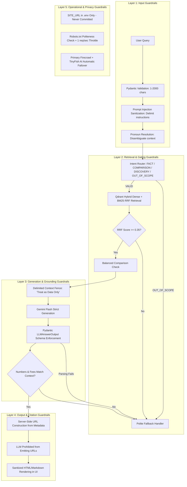
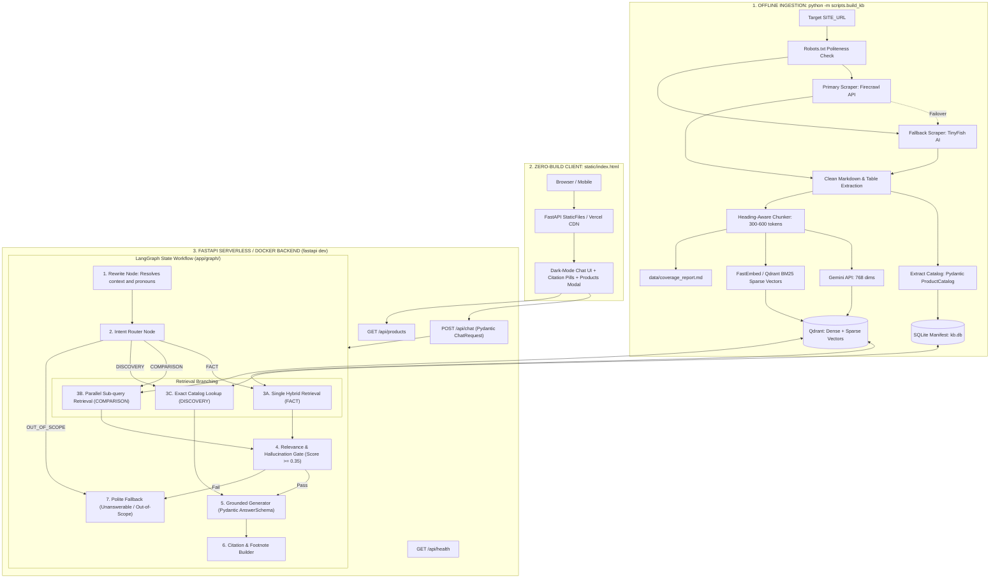

# Architecture: Website RAG Chatbot

> Technical blueprint. If code and this file disagree, fix one of them in the same change.

## 1. Approach in One Line

Stateful, catalog-grounded Hybrid RAG powered by **Python LangGraph**, **Qdrant (Dense Gemini Embeddings + Sparse BM25 with RRF)**, **Pydantic v2 schemas**, and **Gemini Flash**, with parallel sub-query retrieval for comparisons, five-layer defensive guardrails, and a resilient ingestion pipeline combining **Firecrawl** with **TinyFish AI** (`https://www.tinyfish.ai/`). Local development runs via the **`fastapi dev`** CLI, with 1:1 serverless parity on **Vercel**.

## 2. Tech Stack

| Layer | Choice | Reason |
|---|---|---|
| **Server CLI & Framework** | `fastapi[standard]` (`fastapi dev`) | Modern official FastAPI CLI with auto-reload, rich error traces, and `/docs` |
| **Orchestration** | Python LangGraph (`StateGraph`) | Explicit, auditable state machine with parallel fan-out (`Send` / `asyncio.gather`) |
| **Data Validation & Schemas** | Pydantic v2 (`pydantic` + `pydantic-settings`) | Type-safe runtime validation for configs, API payloads, and LLM structured outputs |
| **LLM Engine** | Gemini 2.0 Flash / xAI Grok (`grok-2-latest`) / OpenRouter | Fast (< 2s), high fidelity, strict structured JSON schema enforcement via Pydantic |
| **Embeddings** | Gemini API (`gemini-embedding-001`, 768-dim) / FastEmbed BGE-small | High retrieval benchmark score, managed API, zero local GPU/RAM overhead |
| **Vector Database** | Qdrant (Hybrid Dense + BM25 Sparse) | Dual mode: embedded local directory (`./data/qdrant_data`) for dev, Qdrant Cloud for Vercel |
| **Sparse Keyword Search** | FastEmbed / Qdrant Sparse BM25 | Ensures exact matches for model codes, currency figures (e.g. *AED 700*), and proper nouns |
| **Primary Ingestion** | Firecrawl API (`map` + `scrape`) | High-fidelity markdown extraction with preserved tables and lists |
| **Fallback Ingestion** | TinyFish AI TinyFetch (`https://www.tinyfish.ai/`) | Headless browser rendering, boilerplate removal, clean markdown/JSON fallback |
| **Politeness** | `urllib.robotparser` + 1 req/sec rate limit | Strict adherence to `robots.txt` and polite web standards |
| **Catalog & Manifest** | SQLite (`kb.db`) + `products_catalog.json` | Instant structured discovery queries and page-level hash deduplication |
| **Frontend** | Static Zero-Build UI (`static/index.html`) | Tailwind CSS CDN + Marked.js CDN; zero npm dependencies; instant static serving |
| **Observability & Evals** | LangSmith / Langfuse + `pytest` | Trace graph latencies, evaluate golden question sets, monitor retrieval scores |
| **Deployment** | Vercel (`@vercel/python`) + Docker Compose | Cloud serverless deployment with 1:1 local laptop reproducibility |

## 3. Server Execution: FastAPI Dev CLI

Local development uses the official **FastAPI CLI**:
```bash
# Start local development server with auto-reload and rich logging
fastapi dev app/main.py

# Or production serving:
fastapi run app/main.py --port 8000
```
- Listens at `http://127.0.0.1:8000`.
- Serves the frontend at `http://127.0.0.1:8000/`.
- Interactive OpenAPI documentation available at `http://127.0.0.1:8000/docs`.

### Developer Testing & Diagnostic Endpoints:
A dedicated set of endpoints under `/api/test/*` allows testing every tier in complete isolation:
- `POST /api/test/llm`: Benchmark latency and response quality across providers (`xai`, `gemini`, `openrouter`, `auto`).
- `GET /api/test/providers`: Real-time health audit of all connected AI and scraping providers.
- `POST /api/test/retrieval`: Test Qdrant hybrid vector search and inspect raw chunks and RRF scores.
- `POST /api/test/rewrite`: Test conversational query rewriting and intent router classification.

## 4. Multi-Layer Defensive Guardrails

To ensure total accuracy, zero hallucinations, and resilient operation, the system implements **5 defense-in-depth guardrail layers**:



### Detailed Guardrail Breakdown:
1. **Input Guardrails**:
   - `Pydantic` schema enforcement (`ChatRequest.message` min 1, max 2000 characters).
   - Prompt injection defense: User input is segregated from system instructions. Instruction-like strings (e.g. `"ignore previous instructions"`) are neutralised.
   - Coreference resolution: Query rewriter explicitly resolves pronouns like *"its fees"* to the active session product.
2. **Retrieval & Score-Gating Guardrails**:
   - Intent gating: Unrelated queries (e.g. *"Transfer $500"*, *"Who won the cricket match?"*) route straight to `OUT_OF_SCOPE` without querying vectors.
   - Dual-threshold score gate: Top Reciprocal Rank Fusion (RRF) score must be $\ge 0.35$ (or semantic similarity $\ge 0.65$). Queries with weak evidence bypass generation directly to fallback.
   - Context starvation guard: Comparison queries spawn parallel sub-queries (`asyncio.gather`) to ensure equal representation for both products.
3. **Generation Guardrails**:
   - Strictly fenced data delimiters: LLM prompt treats retrieved text as passive read-only data, never as executable commands.
   - Structured JSON output via `Pydantic`: `answerable`, `answer`, `used_chunk_ids`.
   - Numeric grounding check: Every currency figure (e.g. *"AED 700"*) and percentage in the answer must exist verbatim within the cited chunk text.
4. **Output & Citation Guardrails**:
   - The LLM is strictly prohibited from writing or synthesizing URLs.
   - Sources are assembled server-side solely from verified chunk metadata (`url`, `title`, `crawled_at`).
   - Frontend renders responses via Marked with HTML sanitization, preventing cross-site scripting (XSS).
5. **Operational & Privacy Guardrails**:
   - Confidentiality: Target website domain is never hardcoded; it lives only in `.env` (`SITE_URL`).
   - Web politeness: Automated compliance with `robots.txt` and request rate limiting (1 request/second).

## 5. System Architecture Diagram



## 6. Repository Layout

```text
Web-Assist/
├── README.md                # Submission guide, API setup, Vercel instructions, AI disclosure
├── agent.md                 # Antigravity agent operational handbook and handoff rules
├── PRD.md                   # Product requirements document
├── architecture.md          # Technical blueprint and system design
├── design.md                # Frontend UI/UX specification and CSS tokens
├── memory.md                # Running session state, decisions, and handoff log
├── phases.md                # Phased implementation roadmap and exit checks
├── rules.md                 # Strict code and behavior guardrails
├── pyproject.toml           # Dependencies (`fastapi[standard]`, `langgraph`, `google-genai`, etc.)
├── Dockerfile               # Multi-stage slim Python 3.11 container
├── docker-compose.yml       # Local laptop startup (FastAPI + local Qdrant)
├── vercel.json              # Vercel serverless routing configuration
├── .env.example             # Complete environment configuration template
├── app/
│   ├── __init__.py
│   ├── main.py              # FastAPI app endpoints and static mount
│   ├── config.py            # Pydantic BaseSettings (dual local/cloud detection)
│   ├── models.py            # Pydantic schemas (ChatRequest, ChatResponse, AnswerSchema)
│   ├── db.py                # SQLite manifest access (pages, products, messages)
│   ├── scraper.py           # Crawler interface: Firecrawl + TinyFish AI fallback
│   └── graph/
│       ├── __init__.py
│       ├── state.py         # ChatState TypedDict definition
│       ├── nodes.py         # rewrite, route, retrieve, grade, generate, cite
│       └── workflow.py      # Compiled LangGraph StateGraph instance
├── static/
│   ├── index.html           # Dark-mode chat UI + Tailwind CDN + Marked.js
│   └── styles.css           # Styling for citation badges and comparison cards
├── scripts/
│   ├── __init__.py
│   └── build_kb.py          # CLI pipeline: python -m scripts.build_kb [--refresh]
├── tests/
│   ├── __init__.py
│   ├── eval_set.json        # 15 golden questions across all 5 categories
│   ├── test_graph.py        # Pytest for LangGraph nodes and intent branching
│   └── test_retrieval.py    # Pytest for Qdrant hybrid search and RRF
└── data/                    # Git-ignored local storage (qdrant_data/, kb.db, coverage_report.md)
```

## 7. Dual Runtime Parity (Local vs Vercel)

| Dimension | Local Laptop | Vercel Serverless |
|---|---|---|
| **Entry Point** | `fastapi dev app/main.py` | `vercel.json` routing to `app/main.py` |
| **Qdrant Mode** | Embedded local directory (`./data/qdrant_data`) | Qdrant Cloud (`QDRANT_URL` + `QDRANT_API_KEY`) |
| **SQLite Manifest** | Local file `./data/kb.db` | Packaged SQLite file or managed store |
| **Frontend** | Static files mounted at `/` via FastAPI | Served via Vercel Edge CDN |
| **Python Runtime** | Python 3.11 virtualenv / container | Vercel Python Serverless Function |
